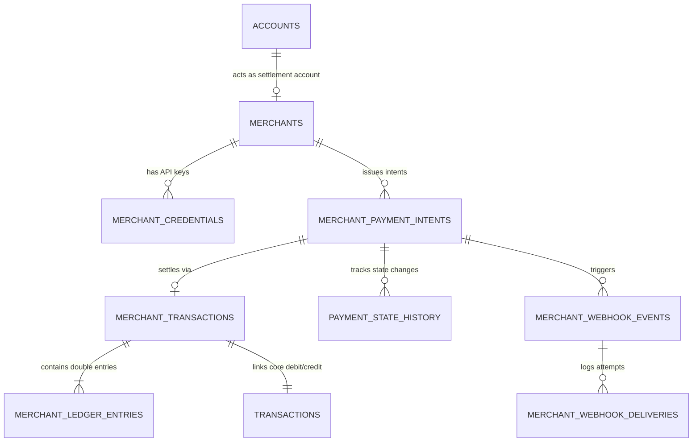

# Merchant Double-Entry Ledger Design

## 1. Accounting Principles

Dhruva Bank follows standard double-entry bookkeeping for all merchant transactions:
- **Debit**: Decreases customer liability (reduces passenger account balance).
- **Credit**: Increases merchant liability (increases merchant settlement account balance).
- **Balance Invariant**:
  $$\sum \text{Debits} = \sum \text{Credits} = \text{Payment Amount}$$

Every merchant payment produces two matching ledger entries linked under a single atomic transaction.

---

## 2. Table Relationships

---

## 3. Atomic Execution Guarantees

1. **Row-Level Locking**: When executing a payment, the database locks the passenger account and merchant settlement account rows in an ordered sequence to avoid deadlocks.
2. **Pre-flight Invariants**:
   - Payer balance $\ge$ Intent amount.
   - Payer status = `ACTIVE`.
   - Merchant settlement account status = `ACTIVE`.
   - Merchant status = `ACTIVE`.
   - Intent status $\in \{\text{'CREATED'}, \text{'CHECKOUT\_PENDING'}\}$.
   - Expiry timestamp $>$ Current UTC timestamp.
3. **Rollback & Compensation**: If the credit leg or transaction audit recording fails, the debit is immediately reverted, ensuring the ledger remains balanced.
4. **Independent Status Isolation**: The bank account transaction status (`public.transactions`) is decoupled from the merchant payment state machine (`public.merchant_payment_intents`).

