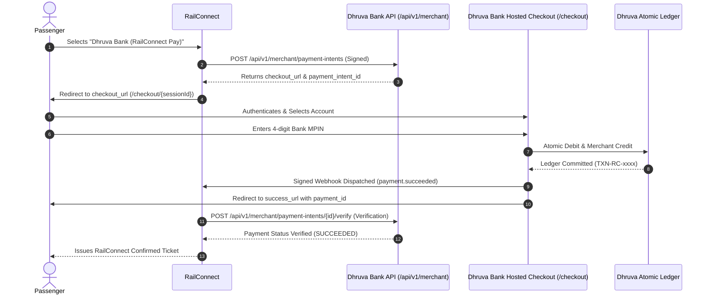

# RailConnect Merchant Integration Guide

## Overview
This document specifies how **RailConnect** (or any authorized booking system) integrates with **Dhruva Bank Merchant Payment Gateway (RailConnect Pay)**.

> [!NOTE]
> **DEMO ENVIRONMENT NOTICE**  
> Dhruva Bank is an educational simulation. No real money or banking networks are involved. All payments, balances, accounts, and MPIN authentications are strictly simulated for testing and educational purposes.

---

## 1. High-Level Flow



---

## 2. Integration Credentials & Configuration

To integrate with Dhruva Bank, obtain the following credentials from the Dhruva Bank Admin Console (`/admin/merchants`):

- **Merchant Code**: `RAILCONNECT`
- **Merchant ID**: System UUID
- **API Key**: `key_live_...`
- **API Secret**: `sec_live_...`
- **Webhook Secret**: `whsec_...`

These credentials must be stored strictly in RailConnect's server-side environment variables. **Never expose the API Secret or Webhook Secret to frontend or browser code.**

---

## 3. Server-to-Server Authentication

Every request to Dhruva Bank's `/api/v1/merchant/*` endpoints must include server authentication:

### Method A: HMAC-SHA256 Request Signing (Recommended)
Headers required:
- `x-merchant-key`: Your `api_key`
- `x-timestamp`: Current Unix timestamp in seconds (`Math.floor(Date.now() / 1000)`)
- `x-signature`: Hex-encoded HMAC-SHA256 of `${timestamp}.${rawJsonBody}` using your `api_secret`

Example Node.js Signing Code:
```typescript
import crypto from "crypto";

function signRequest(apiKey: string, apiSecret: string, bodyObj: any) {
  const timestamp = Math.floor(Date.now() / 1000);
  const rawBody = JSON.stringify(bodyObj);
  const signature = crypto
    .createHmac("sha256", apiSecret)
    .update(`${timestamp}.${rawBody}`)
    .digest("hex");

  return {
    "Content-Type": "application/json",
    "x-merchant-key": apiKey,
    "x-timestamp": timestamp.toString(),
    "x-signature": signature,
  };
}
```

### Method B: Bearer Secret Token
Headers required:
- `x-merchant-key`: Your `api_key`
- `Authorization`: `Bearer <api_secret>`

---

## 4. API Endpoints

| Method | Endpoint | Description |
|---|---|---|
| `POST` | `/api/v1/merchant/payment-intents` | Creates a new payment intent and returns `checkout_url`. |
| `GET` | `/api/v1/merchant/payment-intents/{id}` | Retrieves current payment status and intent details. |
| `POST` | `/api/v1/merchant/payment-intents/{id}/verify` | Server-to-server authoritative payment verification. |
| `GET` | `/api/v1/merchant/transactions/{id}` | Retrieves settlement transaction & double-entry ledger entries. |
| `GET` | `/api/v1/merchant/account/summary` | Retrieves RailConnect settlement account balance and volume. |
| `POST` | `/api/v1/merchant/webhooks/{id}/retry` | Triggers a retry of a past webhook delivery. |

---

## 5. Idempotency & Safety Guarantees

1. **Idempotent Intent Creation**: Supplying the same `idempotency_key` with the same `merchant_id` will return the existing intent without creating duplicates.
2. **Double-Debit Prevention**: Customer debits and merchant credits are executed inside atomic transactions. If any ledger leg fails, all changes are rolled back.
3. **Never Trust Redirects**: The browser redirect is merely UX routing. RailConnect **must verify the payment** via authoritative webhook signature or the `/verify` endpoint before confirming passenger bookings.

